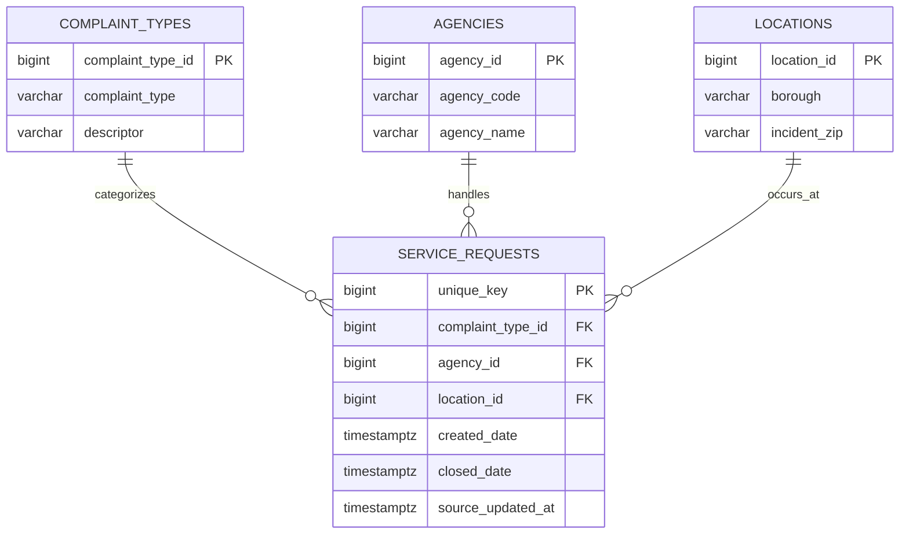

# NYC 311 Service Requests Dashboard - DAEN 328 Team 8

This project extracts NYC 311 Service Requests from 2020 to Present, cleans the records, loads them into PostgreSQL, and will visualize the results in Streamlit. The source is the [NYC Open Data API](https://data.cityofnewyork.us/resource/erm2-nwe9.json); no API key is required.

## Run the project

1. Install and open Docker Desktop.
2. Create the local configuration file:

   ```bash
   cp .env.sample .env
   ```

3. Start the stack:

   ```bash
   docker compose up --build
   ```

The initial run extracts the 50,000 most recent service requests. Later runs query only records with a `unique_key` above the saved high-water mark; the stable API ID is the team's incremental identifier. The checkpoint is stored in PostgreSQL's `etl_state` table only after the load transaction succeeds. Raw API records are saved locally in `data/nyc_311_raw.jsonl` and are ignored by Git.

Run tests in the ETL image with:

```bash
docker compose run --rm etl pytest
```

## PostgreSQL schema

`service_requests` is the fact table and is keyed by the API's stable `unique_key`. It references normalized complaint-type, agency, and location dimensions. The loader creates all tables and indexes through `schema.sql`, then uses PostgreSQL upserts so reruns update an existing request rather than creating duplicates.



## Transform-to-load contract

`load.py` accepts an iterable of cleaned dictionaries. The transform module must preserve `unique_key`, `created_date`, and `:updated_at`; those fields are required for the primary key, source-update audit value, and ETL checkpoint. It can also provide `complaint_type`, `descriptor`, `agency`, `agency_name`, `borough`, `incident_zip`, `community_board`, `city`, `latitude`, `longitude`, `closed_date`, `status`, `resolution_description`, `incident_address`, and `location_type`.

When `transform.py` is merged, `etl.py` automatically calls its `transform_data(records)` function before loading. Until then, the ETL logs that it has loaded the extracted records unchanged.
