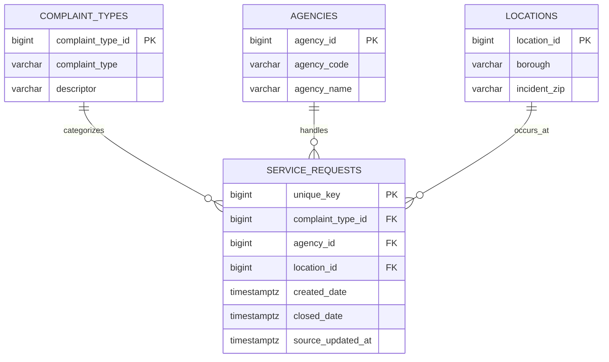

# NYC 311 Service Requests ETL Data Pipeline

Howdy! This is *Team 8's* GitHub repository for our term project in Dr. Mark Lawley's DAEN 328 - Section 500 class. The goal of this project is to create a well-designed ETL data pipeline that extracts data from the "NYC 311 Service Requests from 2020 to Present" dataset API, cleans/normalizes/transforms the data, loads the data into PostgreSQL, & serves data-driven analytics to the end user via a Streamlit dashboard.

## DISCLAIMER
DO NOT COMMIT TO THE MAIN BRANCH YET. MAKE YOUR OWN BRANCH AND WORK THROUGH THERE. [Information on how to do that can be found here.](https://docs.github.com/en/pull-requests/how-tos/commit-changes/managing-branches-within-your-repository)

## Table of Contents
* [Local Setup](#local-setup)
  * [Local Repository Access](#getting-local-access-to-the-repository)
  * [Environmental Variables](#environmental-variables)
  * [Docker Compose](#running-the-project-with-docker)
* [Extraction](#extraction)
  * [The `Extractor` Class](#the-extractor-class)
  * [The `CDC` Class](#the-cdc-class)
* [Transformation](#transformation)
* [Loading](#loading)
  * [PostgreSQL Schema](#postgresql-schema)
  * [Transform-to-Load Contract](#transform-to-load-contract)
* [Visualization](#visualization)
* [ETL Orchestration](#etl-orchestration)
* [Dockerization](#dockerization)

## Local Setup
### Getting Local Access to the Repository 
To gain access to the most up to date versions of the source files from the main branch on your machine, go to your terminal (on MacOS/Linux) or your VSCode terminal (on Windows). Navigate to the directory you'd like to clone into with
```bash
cd /directory/location/here/...
```
Once you are in the preferred directory, clone the repository into it using the command:
```bash
git clone https://github.com/Panflan/DAEN328-Team8.git
```
If you have an SSH key pair configured between your local machine and your GitHub account, you can also use:
```bash
git clone git@github.com:Panflan/DAEN328-Team8.git
```
At this point you should be able to run the project locally, if any issues are encountered, [consult this page](https://docs.github.com/en/repositories/creating-and-managing-repositories/cloning-a-repository)

### Environmental Variables
No API keys or secrets are needed for the project at the moment. `.env.example` provides the necessary structure for your local `.env` file. You will need the API endpoint link (in the example file), a directory path for where you would like to store the raw data, and your postgres credentials

### Running the Project with Docker
In order to test the project, you need to have *Docker Desktop* installed, [you can find the download here](https://www.docker.com/products/docker-desktop/). When trying to run tests on the project, you must have docker desktop open in the background so that the *docker daemon* is awake. Once you have opened docker desktop, you can enter the following command into your terminal to run the project:
```bash
docker compose up --build
```
If you are unfamiliar with the terminal, know that you can always stop the docker process by pressing `ctrl + C`.

Additionally, if you wish to run tests on the ETL image using PyTest, you can instead run the project with the command:
```bash
docker compose run --rm etl pytest
```


## Extraction
The extraction branch of the project was engineered by **Will Gallegos**. We tackled the extraction process using an object oriented approach, encapsulating functionality inside of 2 primary classes that are initialized as objects (one of these classes uses composition for a facade-like interface , but that will be further documented below). 

We implemented keyset pagination alongside a Change Data Capture (CDC) architecture. Because the `unique_key` field is not chronologically ordered, it cannot be used by itself as a reliable pagination cursor. Instead, extraction state is tracked using a composite cursor consisting of `created_date` and `unique_key`, where `created_date` provides chronological ordering and `unique_key` acts as a tie-breaker. Separately, CDC compares records between complete snapshots to identify records that have been inserted, updated, restored, or deleted. The inner workings of these processes is outlined below.

### The `Extractor` Class
The main purpose of the `Extractor` class is to handle pulling records from the API, write them to JSON, and log every step in the process along the way. This workflow is independent of the state of the records (that is handled by a separate class). There is an `Extractor()` object that needs to be initialized that can then has methods and attributes that allow it to perform the steps outlined above. The initialization, methods, and attributes of the class are all outlined below

#### -- `Extractor(headers, batch_size)` (Initializer) --
An `Extractor` object is to be initialized with two parameters:
* `headers` - A `[str, str]` dictionary containing the HTTP headers for the extraction request from the API.
* `batch_size` - An `int` that specifies how many records we want each consecutive request to attempt to pull.
Consider the example below of an `Extractor()` object being initialized:
```python
http_headers = {
    "Accept" : "application/json"
}
batch_size = 1000
extractor = Extractor(http_headers, batch_size)
```
An `Extractor` object has ten attributes including the two passed in as arguments at initialization, these are:
* `endpoint` - The URL for the API endpoint (not variable for this project, static upon initialization)
* `dump_path` - The file path where the extractor will write the raw data to JSON (not variable for this project, static upon initialization)
* `rq_headers` - The request headers passed in upon the extractor's initialization
* `batch_size` - The maximum number of records pulled from the API on each request, passed in upon the extractor's initialization
* `records_pulled` - The number of records that the extractor has *pulled* from the API (but has not logged or written to JSON yet)
* `records_processed` - The number of records that the extractor has pulled, CDC logged, and written to JSON
* `last_created_date` - The value of the `created_date` column in the last record pulled
* `last_unique_key` - The value of the `unique_key` column in the last record pulled
* `logger` - a logger from Python's standard library `logging` module. Specific to this extractor
* `session` - Used to mount an HTTP adapter to the API so if a request fails, the whole extraction doesn't fail with it (retry logic)

Upon initializing the object, the method handles environmental variable retrieval, creating a session, configuring the retry logic, and creating the HTTP adapter.

#### -- `get_batch()` --
Sends a request to the API for up to `batch_size` records. Records are ordered from oldest to newest by `created_date`, with sharing the same `created_date` being ordered by `unique_key` in ascending order.

When pulling the records, if a pagination state already exists, the `$where` condition in the request parameters specifies that we only want to pull records occurring after the previously stored `created_date` or records with a greater `unique_key` that share the same `created_date`. 

All of these steps are logged by the extractor's `logger` (any possible errors included), if the extractor has pulled zero records up to this point (`self.records_pulled == 0`), then the logger also prints the HTTP request and response.

If successful, the method returns a list of raw JSON parsed from the `response` object (from the `requests` module in Python's standard library).

#### -- `dump_batch(batch)` --
Takes the output from the `get_batch()` method (the `batch` parameter) and writes it to JSONL. Nothing special here, it uses UTF-8 encoding and writes it the file path in the extractor's `dump_path` attribute`

### The `CDC` Class
The main purpose of the `CDC` class is to monitor the state of each record so that we don't end up having repeats, untracked deletions, or updates in the raw data that aren't reflected in the data served to the users. 

The class itself is lightweight, the `CDC()` object only has three attributes (outlined in the initializer section below), we used a composition pattern so that the class is a facade interface for two other classes: `CDCLogger` and `CDCState`. These classes each contain their own methods that are used inside of the facade class's methods; neither are meant to be called outside of the class itself. Very little of the `CDC` classes functionality comes from it's own methods, rather the methods encapsulate the functionality of the two compositional classes's methods. The initialization, methods, and attributes of the `CDC` class, as well as the two compositional classes `CDCLogger` and `CDCState`,  are all outlined below

#### -- `CDC(conn)` (Initializer) --
A `CDC` object is to be initialized with one parameter: `conn`, which is the connection to the PostgreSQL database for CDC state-keeping and logging. a `CDC()` object has four attributes including the the one passed in as an argument at initialization, these are:
* `logger` - A `CDCLogger()` object from the compositional class
* `state` - A `CDCState()` object from the compositional class
* `conn` - The PSQL connection passed in at the CDC's initialization
* `run_id` - The unique run ID assigned to the CDC state from the `start_run` method (more on that below)

The initializer handles creating the compositional objects and getting a unique CDC run ID internally.

#### -- `CDC().process_batch(batch)` --
Takes the output of the `get_batch()` method from the `Extractor` class (the `batch` parameter), and uses state hashing to track whether a record is new, or is an update of a previously processed record. 

How this process works is further outlined under the `CDCState().calculate_hash`, `CDCState().get_existing`, and `CDCState().update_state` methods as all of these methods are used internally by this method. 

In short, each record has a unique hash generated, and if during the next snapshot, the new hash is identical to the old hash, then the record hasn't changed at all since the data used to generate the hash must be the same, and is ignored. If the new hash differs from the old hash, then the record was updated since the data used to generate the old hash must've changed. If there is not a pre-existing hash associated with the record's unique key, then the record is being inserted since it's never been processed before.

Once the state of each record has been determined, the method logs each records unique key along with the operation being performed: either `INSERT` for new records, `RESTORE` for deleted records that are being re-entered (more on this later), or `UPDATE` for pre-existing records that are being updated. Unchanged records are not logged.

Once logged, it then updated each records state inside the CDC database using the `CDCstate().update_state` method.

#### -- `CDC().process_deletions()` --
The nature of the `DELETE` operation occurring on pre-existing records means that processing any possible deletions needs to occur once the entire extraction for that unit (whether its hourly, daily, weekly, etc.). 

We can't process deletions as they come in with each individual batch because the deletion of a pre-existing record depends entirely on whether that record is present in the next snapshot from the API. Thus we have this second method just for deletions that runs at the conclusion of the batch processing loop for each snapshot.

In the CDC database, along with records being classified based on their unique key and their most recent operation, they also have an activity state that determines whether the record currently exists or not in the data being written to JSON. 

This means that records that may have once existed, while not stored in the main database, are still logged in the CDC database so that we can identify if these records are recovered at an API-level later.

#### -- `CDC().start_run(conn)` --
Intakes the connection to the CDC PSQL database, and uses that connection create a new row in the `cdc_runs` table that automatically generates an in-order run_id that can be passed to the `CDC()` object during initialization.

#### -- `CDC().finish_run(conn, run_id)` --
Intakes the connection to the CDC PSQL database, and the current run ID for the CDC logger so that it can update the `completed_at` field in the CDC runs table to the current time stamp for that specific run.

#### -- `CDCLogger().log_changes(conn, changes)` --
Intakes the connection to the CDC PSQL database and a list of tuples containing the source ID (the `unique_key` for a given record) and the operation performed on that record. Each change made is then logged in the `cdc_change_log` table in the database.

#### -- `CDCState().calculate_hash(record)` --
Intakes the raw JSON (the `record` argument is read as a python dictionary), normalizes the contents of the record and converts it into one long string, and then calculates a unique SHA256 hash using the `hashlib` module from Python's standard library.

#### -- `CDCState().get_existing(conn, src_ids)` --
Intakes the connection to the CDC PSQL database and a list of unique keys (`src_ids`) that we want to check the state of. 

Returns a dictionary of the unique keys, each pointing to a tuple containing their respective hash and activity status (if they exist).

#### -- `CDCState().update_state(conn, records, run_id)` --
Intakes the connection to the CDC PSQL database, a list of tuples containing the record's unique key and their new hash, and the current run's ID. 

The method inserts all of the record's states into the `cdc_state` table while also adding the date-time that the record was last checked at (and setting it to the current time) and automatically assigning it's activity status to `TRUE`.

#### -- `CDCState().get_deleted(conn, run_id)` --
Intakes the connection to the CDC PSQL database and the current run ID, it checks the CDC state table for records that existed in previous runs that did not exist in the current run. 

For all records found that fulfill that condition, their unique keys are returned by the method as a list of strings.

#### -- `CDCState().mark_deleted(conn, src_ids)` --
Intakes the connection to the CDC PSQL database, and a list of strings containing unique keys for records that have been deleted (gathered from the `CDCState().get_deleted` method), this method sets the active status of all deleted records to `FALSE` inside the `cdc_state` table.

## Transformation

## Loading

### PostgreSQL Schema
`service_requests` is the fact table and is keyed by the API's stable `unique_key`. It references normalized complaint-type, agency, and location dimensions. The loader creates all tables and indexes through `psql_schema.sql`, then uses PostgreSQL upserts so reruns update an existing request rather than creating duplicates.



### Transform-to-load Contract
Inside of the ETL image, the `load_record(records, connection)` function from `load.py` accepts an iterable of cleaned dictionaries (from the `transform.py` module), which must contain `unique_key` and `created_date`, and can also contain: 
* `complaint_type`
* `descriptor`
* `agency`
* `agency_name`
* `borough`
* `incident_zip`
* `community_board`
* `city`
* `latitude`
* `longitude`
* `closed_date`
* `status`
* `resolution_description`
* `incident_address`
* `location_type`

When `transform.py` is merged, `etl.py` automatically calls its `transform_data(records)` function before loading. Until then, the ETL logs that it has loaded the extracted records unchanged.

## Visualization
The dashboard connects to the PostgreSQL database and retrieves the cleaned service request data by the ETL pipeline. The dashboard is designed to help users identify patterns in service requests across NYC's 5 boroughs and over time. 

Dashboard features:
- Borough and year filters: allow users to narrow the displayed data by borough and year
- Displays the total service requests matching the filters
- Shows the most common complaint types and their frequency
- Shows how service request volume changes over time
- Compares the distribution of service requests across NYC boroughs

Data handling:
The dashboard gets data directly from PostgreSQL and uses relational tables created by the loading component. 

Running the dashboard:
python -m streamlit run streamlit_app.py
## ETL Orchestration

## Dockerization

